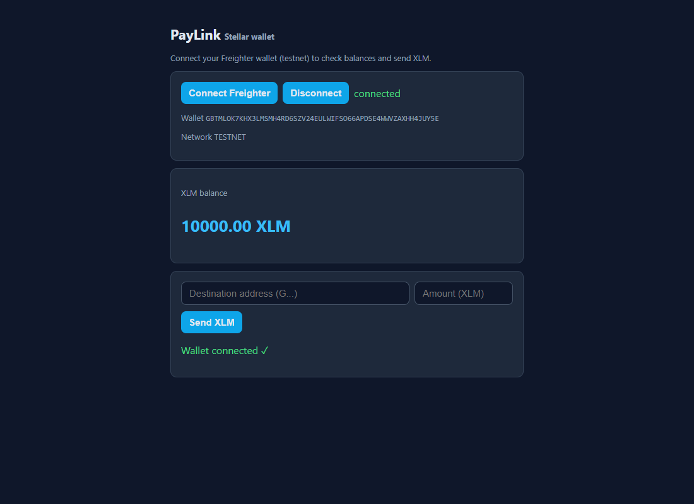
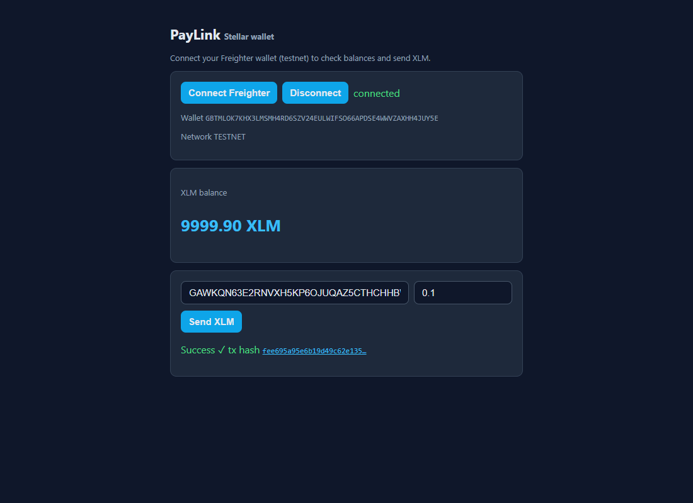

# PayLink — Stellar Payment Links

A complete Stellar testnet payment-link product: Freighter wallet dApp, Soroban
escrow smart contract, and a live merchant dashboard with QR payment links.

Built for the **Stellar Journey to Mastery: Monthly Builder Challenges**
($20,000 prize pool). One product carried through the belt levels.

## Features

- **Level 1 — Wallet dApp** (`level1-web/`): connect/disconnect Freighter,
  live XLM balance, send XLM on testnet with success/failure feedback and
  transaction hash.
- **Level 2 — Smart contracts** (`level2/`): invokes the deployed PayLink
  Soroban escrow contract (create → fund → claim), streams contract events
  in real time, and demonstrates a 2-of-2 multisig account.
- **Level 3 — dApp** (`level3/`): Express backend + frontend merchant
  dashboard. Create payment links backed by on-chain escrow, QR codes for
  sharing, customer pay page, live payment feed from contract events.
- **Web tool** (`web/`): a professional, dependency-minimal Vite single-page
  tool. Connect a wallet, build an amount/asset payment link, share it by URL
  or inline QR code, and watch inbound escrow payments stream in live. Ships a
  dependency-free SVG QR renderer, an animated escrow flow GIF, and a
  hand-tuned design system (semantic palette, optical heading tracking, capped
  measures, custom easing) that deliberately avoids the "AI-vibe-coded" default
  look.

## Web tool

The `web/` directory is a self-contained Vite application (vanilla JS + CSS,
no UI framework).

```bash
cd web
npm install
npm run dev      # http://localhost:3100 (hot reload)
npm run build    # production build into web/dist
npm run preview  # serve the production build
```

From the repo root you can also run `npm run web`, `npm run web:build`, or
`npm run web:preview`.

The animated hero GIF is generated offline by `web/scripts/gen-gif.mjs`
(`node web/scripts/gen-gif.mjs`) using a fixed 5-color palette from the design
tokens, so it stays tiny (~3 KB) and matches the site colors exactly.

## Smart contract

`paylink-contract/` — Soroban escrow written in Rust (soroban-sdk 27).

- `create(link_id, payee, asset, amount)` — merchant creates a payment link
- `fund(link_id, payer)` — customer locks funds into escrow
- `claim(link_id, payee)` — merchant releases funds when the service is done
- Events: `Funded`, `Claimed` (streamed live by the dashboard)

Deployed on testnet:

- Contract: `CAUAHW4XE2F7VMWTOIUBHV43CQAVD6SR7CFD2UCHTHW5U7ZJSLJETOMN`
- Explorer: <https://stellar.expert/explorer/testnet/contract/CAUAHW4XE2F7VMWTOIUBHV43CQAVD6SR7CFD2UCHTHW5U7ZJSLJETOMN>

## Run locally

```bash
npm install

# Level 1: wallet dApp (Freighter extension required)
npm run level1-web

# Level 2: contract flow + event streaming + multisig (testnet)
npm run level2

# Level 3: merchant dashboard + QR + live feed (testnet)
npm run level3
# open http://localhost:3001
```

## Screenshots

### Wallet connected, balance displayed



### Successful testnet transaction



## Tech stack

- Rust + soroban-sdk 27 (Soroban smart contract, `no_std`, wasm32v1-none)
- Node.js + @stellar/stellar-sdk 16, Express
- Stellar testnet (Friendbot funding, Soroban RPC)